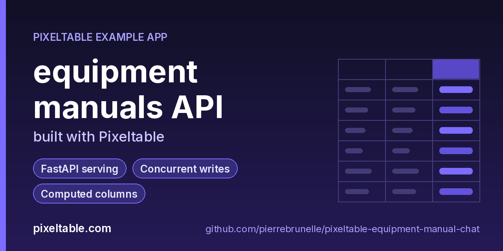

<!-- pixeltable-example-app: 20261027-equipment-manual-chat -->
# Build a chat-with-your-PDFs API in Python

**Short answer:** store each PDF in a Pixeltable table, create a view with `document_splitter(doc, separators='page,token_limit', limit=200, metadata='heading,page')` so every chunk keeps its page number, and put an `EmbeddingIndex` on the chunk text. A `@pxt.query` returns the top-k chunks by `.similarity()`, and a `questions` table uses that query as a computed column, builds a numbered prompt and calls `gpt-4o-mini`, so every inserted question is stored with its answer and its sources. One `FastAPIRouter` exposes uploads, `/ask`, `/search` and exact fault-code lookup. New manuals are chunked and embedded on insert: no separate vector database, no LangChain pipeline, no hand-written FastAPI handlers.

**Replaces:** Pinecone + LangChain + FastAPI

**Use case:** [pixeltable.com/use-cases/production-rag-implementation](https://pixeltable.com/use-cases/production-rag-implementation)



[](https://codespaces.new/pierrebrunelle/pixeltable-equipment-manual-chat?quickstart=1)
[](https://pixeltable.com)
[](https://pypi.org/project/pixeltable/)
[](https://github.com/pixeltable/pixeltable)
[](LICENSE)

`Manuals` holds one row per manual (`manual_id`, equipment, vendor and the file as `pxt.Document`, PDF or Markdown). The `Chunks` view runs `document_splitter` over each manual: one chunk per page, split again at 200 tokens, with the 0-based `page` (PDF) and the `heading` path (Markdown) as columns, plus a `codes` column that pulls fault codes (E12, ALM-14, F5, ...) out of each chunk for exact lookups. An `EmbeddingIndex` (`text-embedding-3-small`) on the chunk text powers `search_chunks`. `Questions` is the chat log: inserting a question runs `search_chunks` as a computed column, numbers the excerpts into a prompt, asks `gpt-4o-mini` for an answer that cites [1], [2], ..., and stores the answer, the cited refs and the sources (manual, page, score). The `FastAPIRouter` takes multipart manual uploads, answers questions (`/ask`, or `/ask/preview` without storing), and serves search, fault-code lookup and the manual list. `load_test.py` drives it with parallel clients and checks `cursor()` streaming against concurrent inserts.

[Pixeltable](https://pixeltable.com) is open-source, Python-native **multimodal AI data infrastructure**: tables, incremental computed columns, UDFs, indexes and serving in one library, running locally or on Pixeltable Cloud.

> ⭐ **Like this example?** Star [pixeltable/pixeltable](https://github.com/pixeltable/pixeltable) on GitHub. It helps other developers find it.

## What this example shows

- **FastAPI serving**: one `FastAPIRouter` turns tables and `@pxt.query` functions into typed REST routes (insert, update, delete, compute and query) with OpenAPI docs
- **Concurrent writes**: parallel HTTP clients inserting into and updating the same table
- **Incremental computed columns** powered by plain Python UDFs (`@pxt.udf`)
- **B-tree indexes** declared on the model (`__indexes__`) back the lookup queries
- **Multimodal media columns** with configurable media destinations
- **Importable UDF module**: UDFs live in `udfs.py`; tables, queries and routes live together in `app.py` (Pixeltable resolves UDFs by module path)
- **`pixeltable.toml`** declares a local database and a **Pixeltable Cloud** database, so the same code deploys with `pxt db update`

## Pipeline

| Table / column | Built with | What it holds |
|---|---|---|
| `manuals.doc` | `pxt.Document` | the uploaded PDF or Markdown file |
| `chunks` (view) | `document_splitter(separators='page,token_limit', limit=200, metadata='heading,page')` | one row per chunk with `text`, `page` (PDF), `heading` (Markdown) |
| `chunks.codes` | `fault_codes` UDF | fault / alarm codes in the chunk |
| `chunk_embed` | `EmbeddingIndex` + `openai.embeddings` (`text-embedding-3-small`) | vector index on `chunks.text` |
| `questions.hits` | `search_chunks` (`@pxt.query`) | top-4 excerpts for the question |
| `questions.prompt` | `build_prompt` UDF | numbered excerpts + question |
| `questions.answer` | `openai.chat_completions` (`gpt-4o-mini`) | the cited answer |
| `questions.cited`, `questions.refs` | UDFs | which excerpts were cited; manual, page and score of each |

## Routes

| Route | Kind | What it does |
|---|---|---|
| `POST /manuals` | insert, multipart | upload a manual; it is chunked and indexed in the same request |
| `POST /ask` | insert | answer a question and store it with its sources |
| `POST /ask/preview` | compute | answer without storing |
| `POST /manuals/delete` | delete | remove a manual and its chunks |
| `GET /search` | query | top-k chunks for a question |
| `GET /codes` | query | every chunk that mentions a fault code |
| `GET /manuals/list` | query | the manuals |
| `GET /questions/recent` | query | the latest answered questions |

## Streaming large results

`Chunks.select(...).cursor()` iterates rows one at a time instead of materializing them; use it as a context manager to stop early. `load_test.py sdk` shows that a cursor reads a consistent snapshot: a manual inserted from another process while the cursor is open finishes right away and is not seen by the open cursor.

## What's inside

| File | What it is |
|------|------------|
| `.devcontainer/devcontainer.json` | GitHub Codespaces / Dev Container config: Python 3.12, installs `requirements.txt`, forwards port 8000 |
| `.github/social-preview.png` | Social preview image (1280x640) |
| `CITATION.cff` | Citation metadata (authors, license, release date, keywords) |
| `app.py` | The app: tables declared as Python classes, `@pxt.query` functions, and the `FastAPIRouter` routes |
| `data/manuals/af60-air-compressor.pdf` | Sample data |
| `data/manuals/bw90-dishwasher.pdf` | Sample data |
| `data/manuals/hl300-scissor-lift.pdf` | Sample data |
| `data/manuals/kr48-cnc-router.pdf` | Sample data |
| `data/manuals/rc14-freezer.md` | Sample data |
| `load_test.py` | Concurrency checks for the manual chat API |
| `make_manuals.py` | Write the demo equipment manuals into data/manuals/ (4 PDFs + 1 Markdown file) |
| `pixeltable.toml` | Project config: the local database plus a Pixeltable Cloud database (sizing, deploy excludes) |
| `seed.py` | Load the demo manuals and ask a few questions |
| `udfs.py` | Pixeltable UDFs (`@pxt.udf`) in their own importable module, imported by `app.py` |
| `requirements.txt` / `pyproject.toml` | Dependencies (`pixeltable[serve]>=0.7.21`) |

**Tables**

| Table | Stored columns | Computed columns |
|-------|---------|------------------|
| `manuals` | `manual_id`, `equipment`, `vendor`, `doc` | - |
| `chunks` | - | `codes` |
| `questions` | `question`, `equipment`, `asked_by` | `qid`, `hits`, `prompt`, `response`, `answer`, `cited`, `refs` |

**API routes** (service `manuals_api`)

| Method | Path | Kind | Backed by | Notes |
|--------|------|------|-----------|-------|
| `POST` | `/manuals` | insert | `Manuals` |  |
| `POST` | `/ask` | insert | `Questions` |  |
| `POST` | `/ask/preview` | compute | `Questions` |  |
| `POST` | `/manuals/delete` | delete | `Manuals` |  |
| `GET` | `/search` | query | `search_chunks` |  |
| `GET` | `/codes` | query | `code_lookup` |  |
| `GET` | `/manuals/list` | query | `manual_list` |  |
| `GET` | `/questions/recent` | query | `recent_questions` |  |

## Run in your browser (GitHub Codespaces)

[](https://codespaces.new/pierrebrunelle/pixeltable-equipment-manual-chat?quickstart=1)

1. Click **Open in GitHub Codespaces** above (or [this link](https://codespaces.new/pierrebrunelle/pixeltable-equipment-manual-chat?quickstart=1)). The dev container installs Python 3.12 and `pixeltable[serve]>=0.7.21` from `requirements.txt`.
2. In the codespace terminal, create the tables, seed them and start the API:

   ```bash
   pxt schema update app.py manuals
   export OPENAI_API_KEY=...   # text-embedding-3-small + gpt-4o-mini
   python make_manuals.py      # writes 4 demo PDF manuals + 1 Markdown manual to data/manuals/
   python seed.py              # loads the manuals and asks 5 questions
   pxt service run app.py manuals --port 8000   # open http://localhost:8000/docs
   python load_test.py http http://localhost:8000   # optional: parallel clients
   python load_test.py sdk manuals                  # optional: cursor() streaming + concurrent insert
   ```

3. Codespaces forwards port 8000: open it from the **Ports** tab (or the pop-up) and add `/docs` to the URL for the interactive OpenAPI docs.

## Quickstart

Requires Python 3.11+ and `pixeltable[serve]>=0.7.21`.

```bash
git clone https://github.com/pierrebrunelle/pixeltable-equipment-manual-chat.git
cd pixeltable-equipment-manual-chat
python -m venv .venv && source .venv/bin/activate
pip install -r requirements.txt

# Create the tables in a local catalog directory named `manuals`
pxt schema update app.py manuals

export OPENAI_API_KEY=...   # text-embedding-3-small + gpt-4o-mini
python make_manuals.py      # writes 4 demo PDF manuals + 1 Markdown manual to data/manuals/
python seed.py              # loads the manuals and asks 5 questions
pxt service run app.py manuals --port 8000   # open http://localhost:8000/docs
python load_test.py http http://localhost:8000   # optional: parallel clients
python load_test.py sdk manuals                  # optional: cursor() streaming + concurrent insert
```

Try it:

```bash
curl -s -X POST localhost:8000/manuals -F manual_id=hl300-v2 -F equipment='HydraLift HL-300 scissor lift' -F vendor=HydraLift -F doc=@data/manuals/hl300-scissor-lift.pdf
curl -s -X POST localhost:8000/ask -H 'content-type: application/json' -d '{"question":"The scissor lift shows E12. What do I do?","equipment":null,"asked_by":"night-shift"}'
curl -s 'localhost:8000/search?q=spindle%20overheat&k=3'
curl -s 'localhost:8000/codes?code=ALM-14'
curl -s 'localhost:8000/manuals/list'
```

## Deploy to Pixeltable Cloud

The same `app.py` runs on [Pixeltable Cloud](https://pixeltable.com). Sign in (or get a free trial database with `pxt new`), point the second database entry in `pixeltable.toml` at your own database, then deploy:

```bash
pxt login                       # or: export PIXELTABLE_API_KEY=<your-api-key>
# edit pixeltable.toml: name = 'pxt://<your-org>:<your-db>'
pxt db update pxt://<your-org>:<your-db>                 # build the image and upload the project
pxt schema update app.py pxt://<your-org>:<your-db>       # create the tables at the database root (no per-app folder)
pxt service update app.py pxt://<your-org>:<your-db>      # start the API there
pxt service list pxt://<your-org>:<your-db>              # list hosted services
```

Hosted routes require an API key: send it in the `X-api-key` header (for example `-H "X-api-key: $PIXELTABLE_API_KEY"`). Keep keys in environment variables or `pxt secret set`, never in code.

## Code walkthrough

**1. Business logic is plain Python, in `udfs.py`.** A `@pxt.udf` function can be used as a column expression. Pixeltable records UDFs by module path (`udfs.build_prompt`), so they live in their own importable module rather than inline in the app: the daemon, serving workers and Pixeltable Cloud import it again by that path.

```python
# udfs.py
@pxt.udf
def build_prompt(question: str, equipment: str | None, hits: list[dict] | None) -> str:
    """Number the retrieved excerpts and put the question last."""
    lines = []
    for i, h in enumerate(hits or [], start=1):
        where = h.get('equipment') or h.get('manual_id')
        page = h.get('page')
        loc = f'{where}, page {page + 1}' if isinstance(page, int) else f'{where}'
        text = ' '.join(str(h.get('text') or '').split())
        lines.append(f'[{i}] ({loc}) {text}')
    scope = f'Equipment: {equipment}\n' if equipment else ''
    return 'Manual excerpts:\n' + '\n'.join(lines) + f'\n\n{scope}Question: {question}'
```

**2. Tables are Python classes (`app.py`).** Annotated attributes are stored columns; attributes assigned an expression are **computed columns** (`qid`, `hits`, `prompt`, `response`, `answer`, `cited`, `refs`), evaluated incrementally on every insert or update and recomputed when their inputs change.

```python
# app.py
class Questions(TableModel, name='questions'):
    """A technician's question; retrieval, the cited answer and its sources are computed on insert."""

    question: pxt.String
    equipment: pxt.String | None
    asked_by: pxt.String | None
    qid = pxt.Column(value=pxtf.uuid.uuid7(), primary_key=True)

    hits = search_chunks(question)
    prompt = build_prompt(question, equipment, hits)
    response = openai.chat_completions(
        [{'role': 'system', 'content': SYSTEM_PROMPT}, {'role': 'user', 'content': prompt}],
        model=ANSWER_MODEL,
        model_kwargs={'max_tokens': 250, 'temperature': 0},
    )
    answer = response.choices[0].message.content.astype(pxt.String)
    cited = cited_refs(answer)
    refs = sources(hits)
```

**3. Queries are functions (`app.py`).** `@pxt.query` wraps a Pixeltable query so it can be called from Python or exposed as a route:

```python
# app.py
@pxt.query
def search_chunks(q: str, k: int = 4):
    """Top-k manual excerpts closest in meaning to the question."""
    sim = Chunks.text.similarity(string=q, idx='chunk_embed')
    return (
        Chunks.order_by(sim, asc=False)
        .limit(k)
        .select(Chunks.manual_id, Chunks.equipment, Chunks.page, Chunks.text, score=sim)
    )
```

**4. One router, a full REST API.** `FastAPIRouter` generates request/response models from the column types, validates input, and publishes OpenAPI docs at `/docs`:

```python
# app.py
manuals_api = FastAPIRouter(name='manuals_api')
manuals_api.add_insert_route(
    Manuals,
    path='/manuals',
    inputs=[Manuals.manual_id, Manuals.equipment, Manuals.vendor],
    uploadfile_inputs=[Manuals.doc],
    outputs=[Manuals.manual_id, Manuals.equipment],
)
manuals_api.add_insert_route(
    Questions,
    path='/ask',
    inputs=[Questions.question, Questions.equipment, Questions.asked_by],
    outputs=[Questions.qid, Questions.answer, Questions.refs, Questions.cited],
)
manuals_api.add_compute_route(
    Questions,
    path='/ask/preview',
    inputs=[Questions.question, Questions.equipment],
    outputs=[Questions.answer, Questions.refs],
)
manuals_api.add_delete_route(Manuals, path='/manuals/delete')
manuals_api.add_query_route(path='/search', query=search_chunks, method='get')
manuals_api.add_query_route(path='/codes', query=code_lookup, method='get')
manuals_api.add_query_route(path='/manuals/list', query=manual_list, method='get')
# ... more routes in app.py
```

## FAQ

**How do I build a chat-with-your-PDFs API in Python?**

Put the PDFs in a Pixeltable table with a `pxt.Document` column, add a view that splits them with `document_splitter`, add an `EmbeddingIndex` on the chunk text, and write a `@pxt.query` that orders chunks by `.similarity()`. Use that query as a computed column of a `questions` table and add an `openai.chat_completions` column for the answer. A `FastAPIRouter` turns the insert into `POST /ask`. This repo is that, end to end, in about 150 lines.

**How do I keep page numbers for citations?**

Split with `separators='page,token_limit'` and `metadata='page'`. Each chunk row gets the 0-based page of the PDF it came from; return it from the search query and show `page + 1` next to each source, as `sources()` in `udfs.py` does.

**Do I need a vector database or LangChain for RAG?**

No. The embedding index lives on the chunk column in Pixeltable and is updated when a manual is inserted, updated or deleted; retrieval is a `@pxt.query`. The chunks, embeddings, questions, answers and sources are all tables you can query and version.

**What happens when I upload a new manual?**

`POST /manuals` inserts one row; Pixeltable chunks it, embeds the new chunks and indexes them in the same request, so the next `/ask` can cite it. Delete a manual with `POST /manuals/delete` and its chunks leave the index too.

**How many requests can it handle?**

Run `load_test.py http`. On a laptop, exact fault-code lookups (no model calls) answered about 115 requests/s at 16 parallel clients, semantic `/search` about 8 requests/s (one embedding call each), and `/ask` is bound by the model call (about 1.5 s per answer). Six parallel manual uploads finished in about 2.3 s.

## Learn more

- 🌐 Website: https://pixeltable.com
- 📚 Docs: https://docs.pixeltable.com
- 💻 Source: https://github.com/pixeltable/pixeltable (⭐ star it if Pixeltable is useful to you)
- 📦 PyPI: https://pypi.org/project/pixeltable/
- 🎯 Use case: https://pixeltable.com/use-cases/production-rag-implementation
- 🧩 More example apps: https://pierrebrunelle.github.io/awesome-pixeltable-apps/

**[More Pixeltable example apps →](https://pierrebrunelle.github.io/awesome-pixeltable-apps/)**

---

<sub>Built as part of a daily series of Pixeltable example apps · Pixeltable 0.7.21 · Python, FastAPI, incremental computed columns · Licensed under Apache-2.0.</sub>
